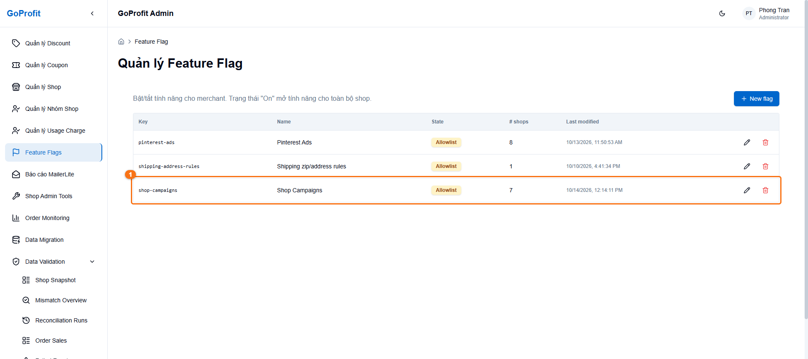
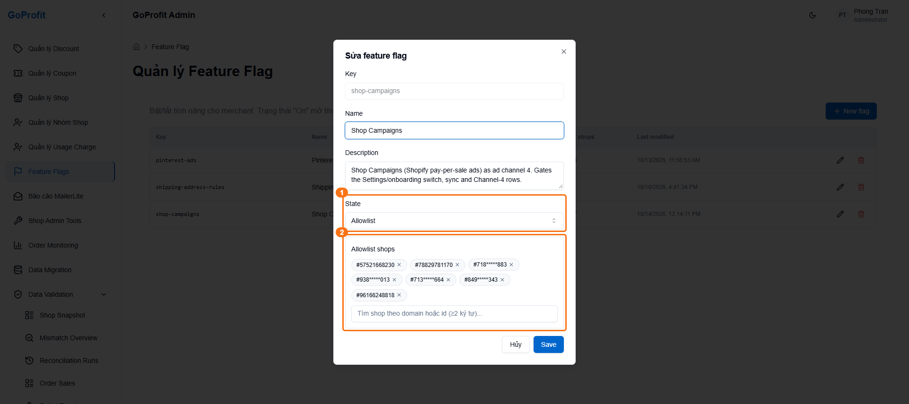
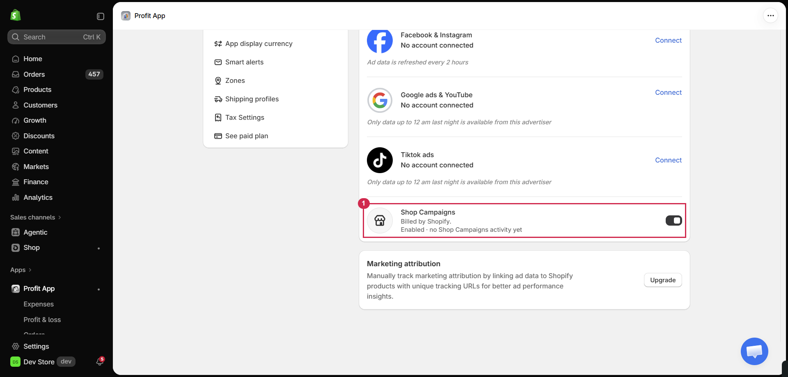
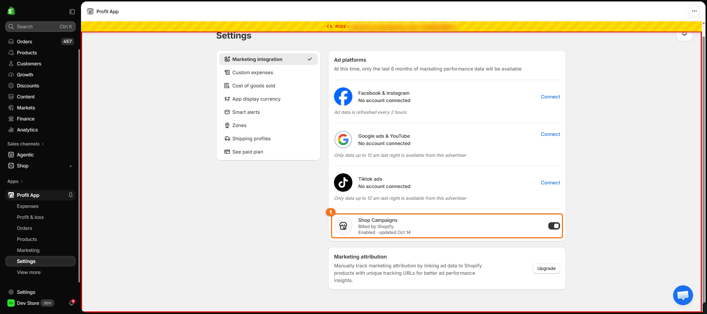
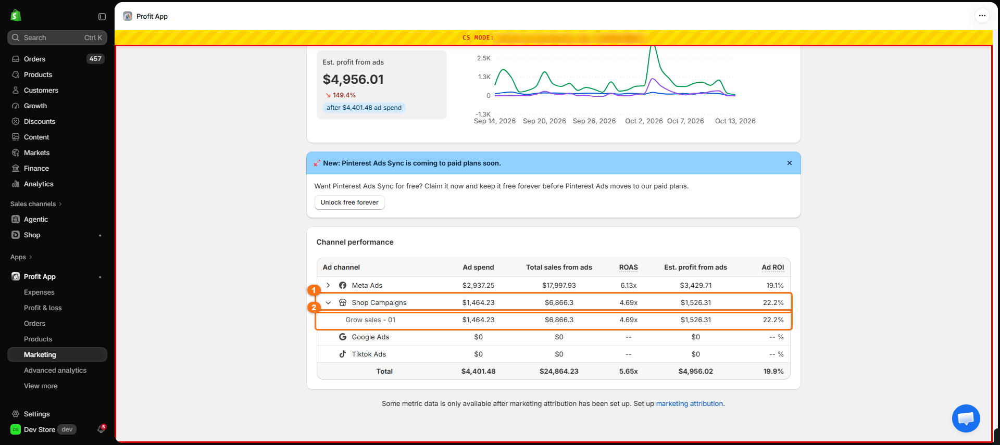
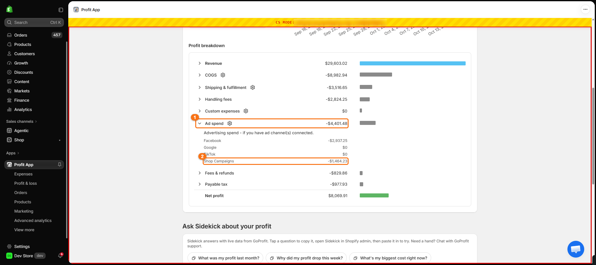
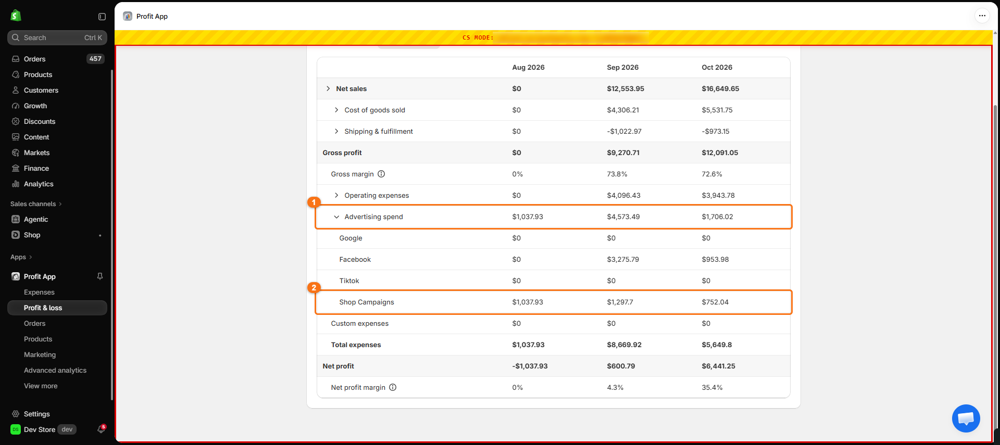
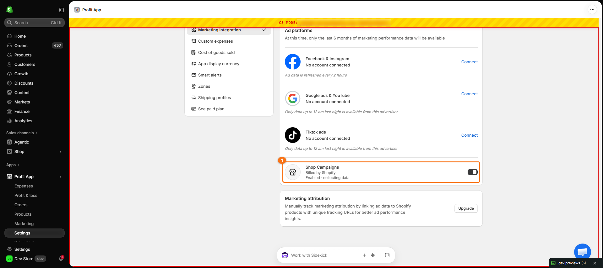
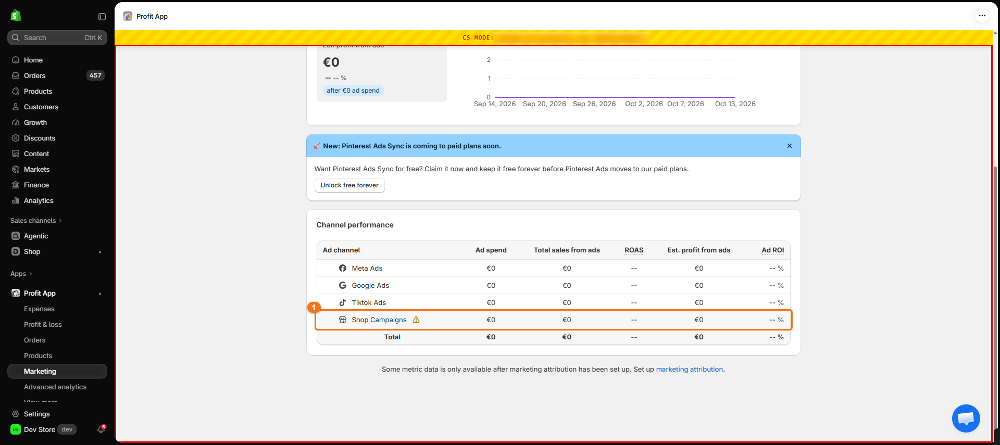

# Shop Campaigns: hướng dẫn test trên môi trường dev

Tài liệu cho người test không cần biết kỹ thuật. Làm theo từng bước, so với ảnh mẫu, ghi lại chỗ nào khác.

## 1. Tính năng này là gì

**Shop Campaigns** là quảng cáo merchant chạy ngay trong Shopify (Shopify tính tiền). Trước đây GoProfit không thấy khoản chi này, nên lợi nhuận bị báo cao hơn thực tế. Từ bản này GoProfit coi Shop Campaigns là **một kênh quảng cáo thứ 5**, cạnh Facebook, Google, TikTok và Pinterest.

Những chỗ thay đổi trong app:

| Màn hình | Thay đổi |
|---|---|
| Settings → Marketing integration | Có thêm dòng **Shop Campaigns** với công tắc bật/tắt và một dòng trạng thái |
| Marketing | Bảng Channel performance có thêm dòng **Shop Campaigns**, mở ra thấy từng chiến dịch |
| Home → Profit breakdown | Mở dòng **Ad spend** thấy thêm dòng **Shop Campaigns** |
| Profit & loss | Mở dòng **Advertising spend** thấy thêm dòng **Shop Campaigns** |

Ảnh mẫu bên dưới: **khung cam có số** là chỗ thay đổi cần nhìn. Viền đỏ quanh app và dải vàng **CS MODE** ở trên cùng là của extension Open Shop, không phải của app.

## 2. Chuẩn bị

1. Đăng nhập Shopify Admin của store dev `store-dev-profit`, mở app **Profit App** (bản dev).
2. Cài extension Chrome **GODISOFT Open Shop**. Extension này cho phép xem app như đang ở một shop khác (gọi là **CS MODE**).
3. Muốn xem shop nào: mở extension, nhập **ShopId** của shop đó, bấm mở. Chờ dải vàng hiện `CS MODE: <domain> (<ShopId>)` rồi mới bắt đầu test.
4. Thoát CS MODE (quay về shop dev gốc) cũng làm trong extension.

Lưu ý khi dùng CS MODE: múi giờ và đơn vị tiền ở một số chỗ có thể theo store dev gốc. Nếu chỉ lệch giờ hoặc tiền tệ trong CS MODE thì ghi chú lại, chưa coi là lỗi.

## 3. Các shop test

Tất cả shop dưới đây đã nằm trong danh sách được bật tính năng trên dev.

| Mã | ShopId | Domain | Đặc điểm | Dùng để test |
|---|---|---|---|---|
| T | `57521668230` | `store-dev-profit.myshopify.com` | Store dev gốc, đang bật Shop Campaigns, **không có** chi tiêu Shop Campaigns | UC1 (trạng thái "no activity"), UC7 |
| N | `78829781170` | `gp-dev-store-002.myshopify.com` | Store dev, đang bật, không có chi tiêu | UC7 (bật/tắt an toàn) |
| O | `96166248818` | `gp-dev-store-p031.myshopify.com` | Store dev, đang bật, không có chi tiêu | Dự phòng cho N |
| S1 | `718*****883` | `4b*****3y.myshopify.com` | Bản sao dữ liệu shop thật. USD, giờ Los Angeles. **Có chi tiêu Shop Campaigns thật** (chiến dịch "Grow sales - 01") và có cả Facebook | UC1–UC4: shop chính để xem số liệu |
| S2 | `938*****013` | `jc*****tk.myshopify.com` | Bản sao shop thật. Tiền **RON (lei)**, giờ Bucharest. Có chi tiêu | UC5 (tiền tệ khác USD) |
| S3 | `713*****664` | `66*****3c.myshopify.com` | Bản sao shop thật. USD, giờ Denver. Có chi tiêu, **không có** kênh quảng cáo nào khác | UC2–UC4 trên shop chỉ có Shop Campaigns |
| S4 | `849*****343` | `9e*****e9.myshopify.com` | Bản sao shop thật. EUR. Shop **chưa cấp quyền đọc báo cáo** cho app, nên GoProfit không lấy được số | UC6 (thiếu quyền) |

ShopId và domain của S1–S4 được che vì là shop của merchant thật, trên ảnh mẫu cũng làm mờ. Mã đầy đủ để nhập vào extension: hỏi team dev.

**Quy định với S1–S4:** đây là bản sao dữ liệu của merchant thật, chỉ để xem. **Không bấm tắt Shop Campaigns** trên S1–S4. Muốn test bật/tắt thì dùng N hoặc O.

### Shop nào được thấy tính năng: màn admin

Tính năng chỉ hiện với những shop nằm trong danh sách cho phép (allowlist). Danh sách này quản lý ở trang admin dev `https://admin.dev.goprofit.dev` → menu **Feature Flags**.

1. Trong bảng, dòng **shop-campaigns** (khung 1) có State là **Allowlist**, và cột # shops cho biết số shop đang được bật.

2. Bấm biểu tượng bút chì ở dòng đó để xem chi tiết:
   - **State** (khung 1) có 3 giá trị: **Off** là tắt với mọi shop, **Allowlist** là chỉ bật cho các shop trong danh sách, **On** là bật cho toàn bộ shop.
   - **Allowlist shops** (khung 2) là danh sách ShopId đang được bật. Danh sách này trùng với 7 shop ở bảng trên.

Người test chỉ xem màn này, bấm **Hủy** để đóng. Muốn thêm hay bớt shop trong danh sách thì nhờ team dev. App chỉ đọc danh sách này một lần mỗi khi tải trang, nên sau khi danh sách đổi phải tải lại trang app (F5) mới thấy.

## 4. Các use case

### UC1. Xem trạng thái trong Settings

**Shop:** T, S1, S4 · **Đường đi:** Settings → Marketing integration → kéo xuống cuối khối Ad platforms.

Kết quả đúng:

- Có dòng **Shop Campaigns**, chữ "Billed by Shopify.", công tắc ở bên phải.
- Dòng trạng thái thay đổi theo shop:

| Shop | Dòng trạng thái mong đợi |
|---|---|
| T | `Enabled · no Shop Campaigns activity yet` |
| S1 | `Enabled · updated <ngày gần nhất>` |
| S4 | `Enabled · collecting data` (không có chữ nào nói về quyền) |

Shop T, chưa có chi tiêu:

Shop S1, có chi tiêu (1 = dòng Shop Campaigns và công tắc):

### UC2. Màn Marketing có dòng Shop Campaigns

**Shop:** S1 (hoặc S3) · **Đường đi:** menu Marketing → bảng **Channel performance**.

1. Tìm dòng **Shop Campaigns** (khung 1).
2. Bấm mũi tên bên trái để mở. Bên dưới hiện từng chiến dịch, với S1 là **Grow sales - 01** (khung 2).

Kết quả đúng:

- Số của dòng Shop Campaigns bằng tổng các chiến dịch con.
- Dòng **Total** cộng cả Meta Ads lẫn Shop Campaigns.
- Không có biểu tượng cảnh báo cạnh Shop Campaigns.

### UC3. Home: chi phí quảng cáo có Shop Campaigns

**Shop:** S1 · **Đường đi:** Home → khối **Profit breakdown** → bấm dòng **Ad spend**.

Kết quả đúng: dòng Ad spend (khung 1) mở ra có thêm dòng **Shop Campaigns** (khung 2). Ad spend bằng Facebook + Google + TikTok + Pinterest + Shop Campaigns. Với cùng khoảng ngày, số Shop Campaigns ở đây khớp số ở màn Marketing.

### UC4. Profit & loss: dòng Shop Campaigns theo tháng

**Shop:** S1 · **Đường đi:** Profit & loss → bấm dòng **Advertising spend**.

Kết quả đúng:

- Advertising spend (khung 1) mở ra có thêm dòng **Shop Campaigns** (khung 2).
- Advertising spend của mỗi tháng bằng tổng các dòng con.
- S1 không có dữ liệu Facebook cho tháng 8, nên Advertising spend tháng 8 **chỉ gồm Shop Campaigns**.

### UC5. Shop dùng tiền khác USD

**Shop:** S2 · Lặp lại UC2 và UC4.

Kết quả đúng:

- Số tiền hiện bằng **lei** (dạng `473,18 lei`), không phải `$`.
- Màn Marketing và Profit & loss có thể lệch nhau vài xu do quy đổi tỷ giá theo ngày. Đây là hạn chế đã biết, không cần báo.

### UC6. Shop chưa cấp quyền

**Shop:** S4.

1. Vào Settings: dòng Shop Campaigns vẫn ghi `Enabled · collecting data` (ảnh dưới, khung 1).
2. Vào Marketing: dòng Shop Campaigns có **biểu tượng tam giác cảnh báo**. Rê chuột vào thì hiện "May be incomplete". Mọi số đều là €0 (ảnh dưới, khung 1).

Kết quả đúng: app không báo lỗi, không hiện con số sai. Chỉ cảnh báo là số có thể thiếu.

### UC7. Bật và tắt Shop Campaigns

**Shop:** N (hoặc O). **Không làm trên S1–S4.**

1. Settings → tắt công tắc Shop Campaigns. Trang không tải lại. Dòng trạng thái đổi sang tắt.
2. Vào Marketing: dòng Shop Campaigns **biến mất** khỏi bảng.
3. Quay lại Settings → bật công tắc. Dòng trạng thái quay về `Enabled · …`.
4. Vào Marketing: dòng Shop Campaigns **xuất hiện lại**.

Kết quả đúng: mỗi lần bấm chỉ đổi một lần, không nháy qua lại, không có thông báo lỗi.

### UC8. Shop ngoài danh sách thử nghiệm

**Shop:** bất kỳ store dev nào **không** có trong bảng ở mục 3.

Kết quả đúng: Settings **không có** dòng Shop Campaigns, màn Marketing **không có** dòng Shop Campaigns. Tính năng đang được bật dần theo danh sách, nên shop ngoài danh sách vẫn thấy app như cũ.

## 5. Khi thấy chỗ khác ảnh mẫu

Gửi cho team dev các thông tin sau:

1. Mã shop, ví dụ: `S1`.
2. Use case và bước, ví dụ: `UC3 bước 1`.
3. Ảnh chụp **cả màn hình**, có dải vàng CS MODE.
4. Thời điểm test (giờ Việt Nam).
5. Khoảng ngày đang chọn trên màn hình.

Số tiền trong ảnh mẫu chụp ngày 14/10/2026, nên ngày khác sẽ ra số khác. Cái cần kiểm là **các dòng có xuất hiện và có cộng khớp nhau không**, không phải đúng từng con số trong ảnh.
