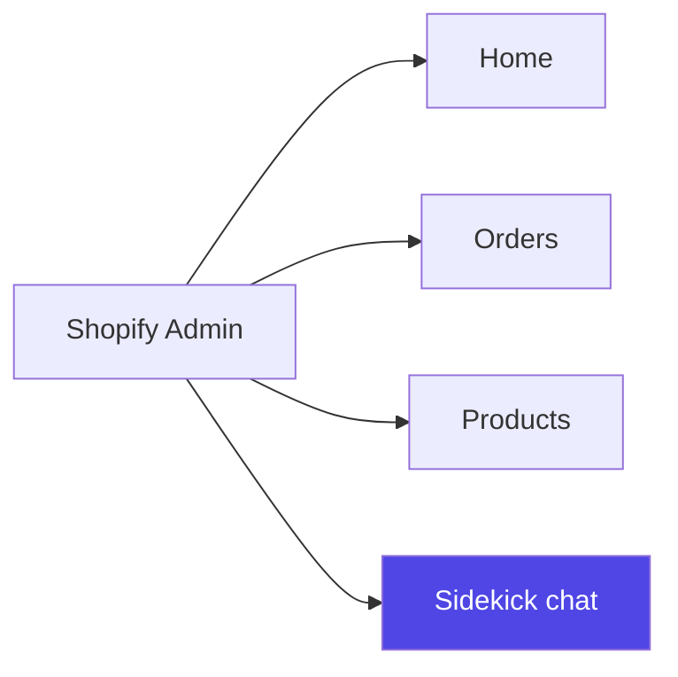
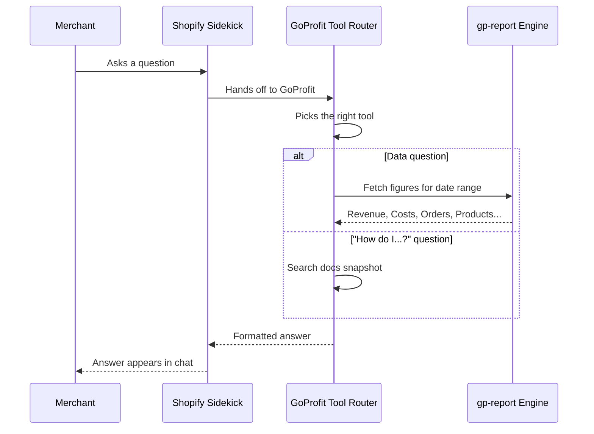

# Shopify Sidekick (GoProfit AI Tools)

Shopify Sidekick is Shopify's built-in AI chat assistant, already inside every merchant's Shopify Admin. GoProfit plugs into it with its own tools, so merchants can ask a plain-English question and get their profit numbers back without opening a dashboard.

## Where to Find It

No separate login, no new app — it lives inside Shopify. Click the Sidekick chat icon and type a question like you're texting a colleague.

## What You Can Ask

Every tool below takes a time period — a named shortcut (today, yesterday, this week, last week, this month, last month, this quarter, last quarter, this year, last year) or an exact date range.

### Profit & Loss
- "What was my profit last month?"
- "Show my profit trend by month this year"
- Returns gross sales, total expenses, net profit, COGS, shipping cost lines, discounts, and ad spend split by channel (Facebook/Google/TikTok).

### Expense Breakdown
- "What is my biggest cost this month?"
- "Break down my expenses for last quarter"
- Returns every expense category (COGS, shipping, label/fulfillment/transaction/processing/handling fees, custom expenses, taxes, ad spend) ranked largest-first for one period. Refunds are shown separately, excluded from the total.

### Order Analytics
- "How many orders did I get this week?"
- "What's my refund rate for last quarter?"
- Returns order count, average order value, and refund % — shop-level totals only, never individual orders or customers.

### Product Analytics
- "What are my best-selling products this month?"
- "Which products get returned the most?"
- Returns top products ranked by net profit (default), net sales, or refund amount — one-time ranking for the period, not a trend.

### Feature Guide (docs search)
Returns an answer from GoProfit's public help docs plus a source link. Currently available on dev only, not yet in production.

**Metrics & Glossary**
- "What is ROAS in GoProfit?"
- "How do you calculate Net Profit?"
- "What is Net Profit Margin?"
- "Explain Average Order Value"
- "What does CAC mean?"
- "What is Customer Lifetime Value?"
- "What is Cost Per Acquisition?"
- "How is Gross Sales / Total Revenue defined?"
- "How is Conversion Rate calculated?"
- "What are Core KPIs?"

**Setup & Configuration**
- "How do I set up COGS in GoProfit?"
- "How does quantity-based COGS work?"
- "How do I connect Facebook Ads?"
- "How do I add custom expenses?"
- "Where do I change the app's display currency?"
- "How do I set up Smart Alerts?"

**Features & Reports**
- "What are Zones in GoProfit?"
- "What does the Marketing Performance page show?"
- "What is the Product Performance report?"
- "Explain the GoProfit Dashboard"
- "Explain the Customer Journey feature"
- "Where can I see Order Analytics?"
- "Where's the Profit & Loss report?"

## How It Works

## Quick Reference

| You want to know... | Ask Sidekick... |
|---|---|
| This month's profit | "What's my profit this month?" |
| Where money is going | "What is my biggest expense this month?" |
| Order volume / AOV | "How many orders did I get last week?" |
| Refund rate | "What's my refund rate this quarter?" |
| Best sellers | "What are my top 5 products by profit this month?" |
| Most-returned products | "Which products get returned the most?" |
| A specific date range | "What was my P&L from May 1 to May 15?" |
| How-to / concept question | "How do I set up COGS?" / "What is ROAS?" (more examples above) |

## Notes

- Be specific about the time period — "recently" is vague, "last 30 days" is clear.
- Expense Breakdown and Product Analytics return one period's snapshot, not a trend — ask separately per period to compare.
- Individual order lookups, per-customer detail, and marketing/ad-channel performance breakdowns aren't available yet.
- No setup needed — works out of the box for any shop with GoProfit installed.
